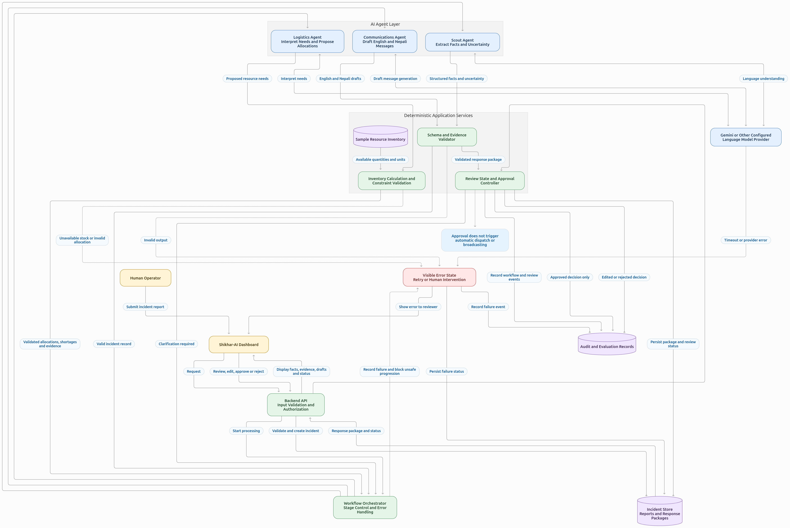

# Shikhar-AI

**A human-supervised, multi-agent AI system for disaster intelligence, resource planning, and emergency communication.**

Shikhar-AI is a disaster-response decision-support prototype designed to transform unstructured emergency reports into structured incident information, evidence-grounded resource recommendations, and draft coordination messages.

The system uses specialized AI agents to organize incoming information, identify missing or uncertain details, evaluate available resources, and prepare communication drafts for human review. It is designed to assist response coordinators—not replace their judgment or operate emergency-response systems autonomously.

## Vision

To build a transparent and reliable AI-assisted platform that helps disaster-response coordinators organize incident information, plan resource allocation, and prepare clear emergency communications under human supervision.

## Core capabilities

- **Incident intelligence:** Extract structured information from incoming disaster reports.
- **Uncertainty detection:** Identify missing, ambiguous, conflicting, or unverified information.
- **Resource planning:** Generate resource recommendations grounded in a sample inventory and documented assumptions.
- **Emergency communication:** Draft English coordination alerts and Nepali public-facing messages.
- **Multi-agent coordination:** Organize specialized agent tasks into a traceable response workflow.
- **Human approval:** Allow reviewers to inspect evidence, edit recommendations, and approve or reject generated outputs.
- **Evaluation and testing:** Assess extraction accuracy, recommendation correctness, uncertainty handling, and workflow reliability.
- **Cloud deployment:** Prepare the prototype for deployment on Google Cloud.

## How it works

1. **Submit a report:** A coordinator provides a simulated disaster report.
2. **Scout Agent:** Extracts incident details, affected locations, reported needs, available evidence, and uncertainties.
3. **Logistics Agent:** Evaluates the available inventory and prepares evidence-linked resource recommendations.
4. **Communications Agent:** Drafts an English coordination alert and a Nepali public-facing message.
5. **Human review:** A coordinator reviews the extracted facts, supporting evidence, resource recommendations, and communication drafts.
6. **Approve or reject:** The coordinator makes the final decision on the response package.

## Project scope

Shikhar-AI is initially developed as a prototype using simulated disaster reports and sample inventory data.

The prototype does not claim to provide verified live disaster monitoring, autonomous rescue dispatch, automatic emergency broadcasting, or integration with government emergency systems unless those capabilities are subsequently implemented, tested, and explicitly authorized.

AI-generated outputs may contain errors. All operationally significant recommendations and messages must be reviewed by an authorized human before use.

## Documentation

Project documentation is organized into the following documents. Click any document to explore its specifications, design decisions, and implementation guidelines.

| Document | Purpose |
|---|---|
| [00 — Project Charter](docs/00-project-charter.md) | Vision, scope, principles, and success criteria |
| [01 — Problem and Users](docs/01-problem-and-users.md) | Problem definition, target users, and assumptions |
| [02 — Requirements](docs/02-requirements.md) | Functional and non-functional requirements |
| [03 — System Architecture](docs/03-system-architecture.md) | System components and architecture |
| [04 — Agent Specifications](docs/04-agent-specifications.md) | Responsibilities and constraints of each agent |
| [05 — Data Contracts](docs/05-data-contracts.md) | Schemas and data exchanged between components |
| [06 — Safety and Human Approval](docs/06-safety-and-human-approval.md) | Safety controls and human approval requirements |
| [07 — Evaluation and Testing](docs/07-evaluation-and-testing.md) | Evaluation methodology and test scenarios |
| [08 — Deployment and Operations](docs/08-deployment-and-operations.md) | Deployment, monitoring, and operational procedures |
| [09 — Demo Script](docs/09-demo-script.md) | Demonstration workflow and example scenarios |
| [10 — Decisions and Risks](docs/10-decisions-and-risks.md) | Architecture decisions, risks, and mitigations |

Architecture assets:

- [Architecture Diagram (Mermaid)](docs/assets/architecture.mmd)
- [Architecture Diagram (PNG)](docs/assets/architecture.png)

## System Architecture

The following diagram illustrates the main components, multi-agent workflow, deterministic resource validation, and human approval paths.

For the editable diagram source, see [architecture.mmd](docs/assets/architecture.mmd) or read the [System Architecture documentation](docs/03-system-architecture.md).

## Development principles

- Evidence-grounded outputs rather than unsupported claims.
- Explicit representation of uncertainty and missing information.
- Human authorization for consequential decisions.
- Traceability from source reports to recommendations.
- Privacy-conscious handling of sensitive information.
- Reproducible tests and measurable evaluation criteria.
- Clear separation between prototype capabilities and real-world operational readiness.

## Current status

**Stage:** Prototype design and development.

The architecture, agent responsibilities, data contracts, safety requirements, and evaluation scenarios will be documented before the corresponding implementation is finalized. Capabilities will be described as implemented only after they have been built and tested.

## Disclaimer

Shikhar-AI is an experimental decision-support prototype. It is not a replacement for emergency services, trained disaster-response personnel, official warnings, or established emergency-management procedures.

In a real emergency, users should follow instructions from authorized emergency-response authorities.

## License

Shikhar-AI is licensed under the [MIT License](LICENSE).

See the `LICENSE` file for the full license text.
